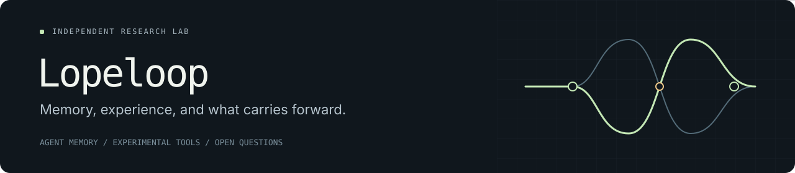

  

### What should an AI carry forward?

Lopeloop is a small independent research lab exploring memory for AI agents:
how experience is preserved, how knowledge changes, and when the past should
influence the next decision.

The work moves between research questions, experimental tools, and working
systems. Current focus: building the infrastructure to test memory ideas
under reproducible conditions.

### On the workbench

**Runloom · In development**

A runner for reproducible retrieval and memory experiments. Work so far
includes frozen experimental plans, verifiable artifacts, interruption
recovery, and two-pass reranker checks. The first public release is being
prepared; memory-backend evaluation is a later milestone.

**Agent memory · Research direction**

Exploring how an agent can recover the current state of a long-running task,
revise outdated assumptions, and retain the conditions under which past
experience is useful. A memory system is a longer-term direction; its
mechanism is still an open question.

### Questions behind the work

- What survives when experience is compressed into memory?
- How should new information change earlier decisions and dependent plans?
- When does a useful memory become the wrong advice?
- Can memory reduce the effort of returning to unfinished work?

### Working principles

Preserve sources and provenance. Separate observations from interpretations.
Test one mechanism at a time. Keep negative results. Make the evidence
inspectable.

---

*Research in progress. Tools and findings will be shared as they become ready
for others to inspect and use.*
